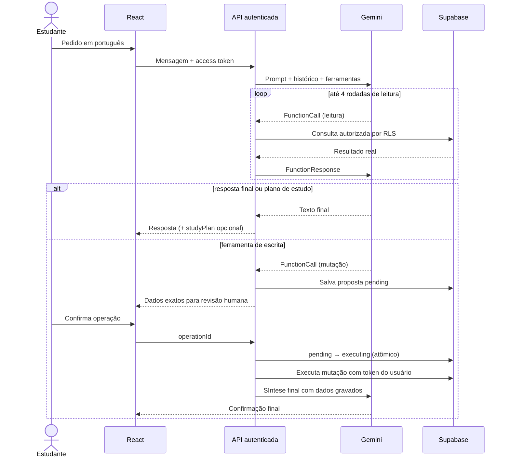
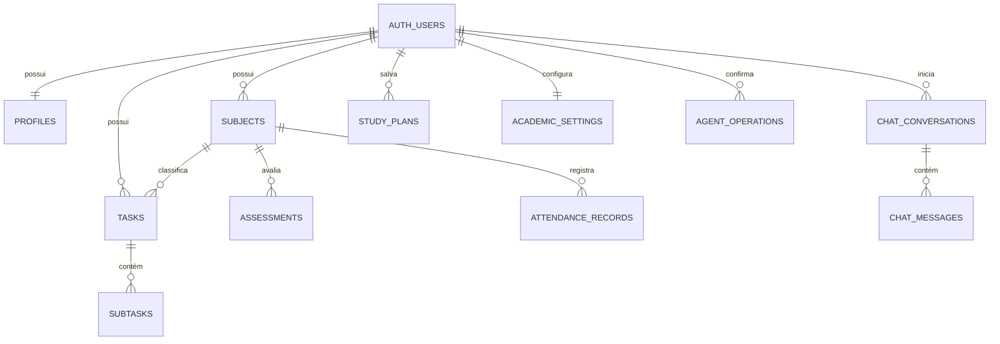

# TaskMind — produtividade acadêmica com agente Gemini

O TaskMind é uma aplicação acadêmica full stack para organizar tarefas, disciplinas, prazos, notas, frequência e planos de estudo. O projeto preserva as seis interfaces criadas no Google Stitch e integra autenticação via Supabase Auth, persistência relacional com Row Level Security (RLS) e um agente Gemini com function calling e confirmação humana obrigatória.

## Problema e justificativa

Informações acadêmicas costumam ficar fragmentadas entre portais, calendários e anotações. Isso dificulta visualizar a carga de trabalho, antecipar atrasos, acompanhar frequência e calcular qual nota ainda é necessária. O TaskMind centraliza esses dados e permite que um agente inteligente consulte informações reais e proponha alterações sem executar ações destrutivas silenciosamente.

## Objetivos

- Manter uma visão única e responsiva da rotina acadêmica.
- Persistir dados por usuário com integridade relacional e Row Level Security (RLS).
- Calcular médias, frequência (regra MEC 75%) e nota necessária com funções determinísticas.
- Usar Gemini para interpretar linguagem natural e encadear ferramentas de consulta.
- Exigir confirmação humana explícita e idempotente para criação, edição e exclusão.

## Funcionalidades

### Implementadas no código

- **Autenticação completa via Supabase Auth:**
  - Login com e-mail e senha (com alternância de visibilidade de senha).
  - **Link mágico** (acesso sem senha via OTP por e-mail).
  - Cadastro com sincronização automática de perfil acadêmico (nome, curso e semestre opcionais).
  - Reenvio de e-mail de confirmação, recuperação/redefinição de senha e tratamento de links expirados na URL.
  - Mensagens de erro e feedback traduzidas para português brasileiro e detecção automática de provedores OAuth (`google` / `github`) quando habilitados no projeto Supabase.
- **Gestão acadêmica persistente:**
  - Rotas da aplicação protegidas por sessão autenticado no [`AuthGate`](src/components/auth/AuthGate.jsx).
  - CRUD completo de tarefas, subtarefas e disciplinas.
  - Persistência de avaliações, registros de frequência, conversas do chat e planos de estudo.
  - Dashboard, calendário e filtros derivados do estado sincronizado.
  - Simulador acadêmico com tratamento de nota zero, disciplinas sem avaliações e metas impossíveis.
- **Agente IA (`/api/agent`) com Gemini + Supabase:**
  - Endpoint autenticado por JWT do Supabase, com rate limit por usuário (`12 req/min`), timeout por chamada (`8s`) e fallback automático de modelos (`gemini-3-flash-preview` → `gemini-3.1-flash-lite` → `gemini-flash-lite-latest`).
  - Encadeamento de múltiplas rodadas de ferramentas de leitura (ex.: `listSubjects` antes de `calculateRequiredGrade`) e correspondência flexível de disciplinas (nome parcial sem acentos ou código).
  - Ferramentas disponíveis: `listTasks`, `createTask`, `updateTask`, `deleteTask`, `listSubjects`, `suggestStudyPlan`, `calculateRequiredGrade` e `getAcademicOverview`.
  - Geração de etapas estruturadas de plano de estudo a partir das tarefas reais em aberto.
  - Propostas de escrita persistidas em `agent_operations` e executadas uma única vez com controle atômico (`pending` → `executing` → `completed`).
  - Fallback local explícito para modo demonstração quando as variáveis do Supabase não estão configuradas.

### Desabilitadas ou pendentes de configuração externa

- Integrações externas (SIGAA, Moodle, biblioteca) e comandos de voz/anexos permanecem desabilitados até haver APIs/armazenamento configurados.
- Login social (Google/GitHub) depende de ativação do respectivo provedor no painel **Supabase Auth → Sign In / Providers**.

## As seis telas

| Tela | Captura |
|---|---|
| Dashboard |  |
| Tarefas |  |
| Assistente |  |
| Calendário |  |
| Disciplinas |  |
| Simulador |  |

As referências completas do Stitch estão indexadas em [`docs/design/README.md`](docs/design/README.md).

## Tecnologias

- **Frontend:** React 19, React Router, Vite 8 e Tailwind CSS v4.
- **Backend:** Node.js 22+ e Express no servidor local (`server.js`); Vercel Serverless Functions (`/api/agent`) em produção.
- **Banco e Autenticação:** Supabase PostgreSQL, Supabase Auth e Row Level Security.
- **IA Generativa:** `@google/genai` (Gemini Developer API).
- **Qualidade:** ESLint 9 e `node:test`.

## Arquitetura

```mermaid
flowchart LR
  Browser[React no navegador] -->|access token| API[/api/agent]
  Browser -->|CRUD com RLS| Supabase[(Supabase PostgreSQL)]
  Browser --> Auth[Supabase Auth]
  API -->|valida token| Auth
  API -->|modelo + fallback| Gemini[Gemini API]
  API -->|token do usuário + RLS| Supabase
  API -->|estado idempotente| Ops[agent_operations]
  Ops --> Supabase
```

O token JWT do usuário define a identidade em todas as consultas e gravações acadêmicas. O backend nunca aceita `userId` enviado pelo navegador ou pelo modelo. A chave secreta (`SUPABASE_SECRET_KEY`) é usada exclusivamente no servidor para controlar a máquina de estados privada de `agent_operations`.

## Fluxo do agente e confirmação humana



Uma segunda confirmação recebe HTTP `409` e não repete a mutação. Falhas marcam a operação como `failed`; a interface não informa sucesso caso a gravação falhe.

## Estrutura principal

```text
api/
  agent.js                 endpoint Vercel e orquestração do agente
  _lib/agentTools.js       módulo privado (schemas, validação e ferramentas)
src/
  components/              layout, AuthGate e modais
  context/                 AuthContext e AcademicContext
  pages/                   seis telas do aplicativo
  services/                cliente Supabase, repositório e cliente do agente
  utils/                   cálculos acadêmicos puros e tradução de erros Auth
supabase/
  migrations/              schema inicial e endurecimento de segurança/RLS
  tests/                   teste SQL de isolamento RLS
tests/                     suítes automatizadas com node:test
server.js                  servidor unificado (Vite + /api/agent) para uso local
vercel.json                configuração de framework e rewrite SPA excluindo /api/
```

## Modelo relacional



Todas as entidades usam UUID, constraints, timestamps, chaves estrangeiras e índices adequados. As migrations criam políticas `SELECT`, `INSERT`, `UPDATE` e `DELETE` separadas por operação.

## Variáveis de ambiente

Copie `.env.example` para `.env` (nunca faça commit do `.env`):

| Variável | Ambiente | Uso |
|---|---|---|
| `VITE_SUPABASE_URL` | navegador/servidor | URL pública do projeto Supabase |
| `VITE_SUPABASE_PUBLISHABLE_KEY` | navegador/servidor | chave publicável protegida por RLS |
| `SUPABASE_SECRET_KEY` | somente servidor | chave secreta para o controle idempotente de `agent_operations` |
| `GEMINI_API_KEY` | somente servidor | chave da Gemini Developer API |
| `GEMINI_MODEL` | somente servidor | modelo principal configurável (padrão `gemini-3-flash-preview` com fallback automático) |
| `APP_URL` | servidor | URL base da aplicação e redirects |

Opcionalmente, `GEMINI_FALLBACK_MODELS` aceita uma lista separada por vírgulas para customizar a ordem de fallback. Nunca use o prefixo `VITE_` em `GEMINI_API_KEY` ou `SUPABASE_SECRET_KEY`.

## Instalação e execução local

Requisitos: **Node.js 22+** e **npm**.

```bash
npm install
npm run dev
```

`npm run dev` inicia Express, a rota `/api/agent` e o Vite na mesma origem (`http://localhost:3000`). Use `TASKMIND_PORT` se a porta 3000 estiver ocupada.

> **Importante:** use `npm run dev` (e não `npm run dev:frontend`) para testar o Assistente IA localmente, pois `dev:frontend` sobe apenas o Vite sem o endpoint `/api/agent`.

## Migrations e RLS

As migrations ficam em `supabase/migrations/`:
- `202611100001_initial_schema.sql`: schema relacional, triggers e RLS inicial.
- `202611100002_agent_security.sql`: tabelas `academic_settings` e `agent_operations` e políticas CRUD granulares.

Para testar isolamento RLS em uma instância local descartável:

```bash
npx supabase start
npx supabase db reset
npx supabase test db
```

Em **Supabase Auth → URL Configuration**, cadastre `http://localhost:3000` e os domínios de preview/produção permitidos em **Redirect URLs**.

## Testes e qualidade

```bash
npm run lint
npm test
npm run build
npm run check
```

Verificação realizada em **11/11/2026**:

- **ESLint** (`npm run lint`): aprovado sem erros.
- **Testes automatizados** (`npm test`): **36 testes em 5 suítes aprovados** (`0` falhas), cobrindo validação de schemas, rate limit, timeout, fallback de modelos, encadeamento de ferramentas, prevenção de mensagens órfãs, idempotência de confirmação, tradução de erros de autenticação e cálculos acadêmicos.
- **Build de produção** (`npm run build`): aprovado via Vite 8.
- **Ciclo ponta a ponta ao vivo (`server.js` + Supabase Auth + Gemini):** verificado bloqueio HTTP `401` sem token, login com usuário efêmero, chamada de leitura (`listTasks` via `gemini-3-flash-preview`), proposta de criação (`createTask`), confirmação humana (`executed: true`) e remoção do usuário de teste.
- **Pendências fora do escopo local:** teste SQL RLS em container descartável (`supabase test db`) e suíte visual E2E completa em navegador após deploy.

## Deploy na Vercel

O projeto já está preparado para deploy contínuo via GitHub + Vercel:

1. Importe o repositório na Vercel mantendo o preset **Vite** e **Node.js 22.x**.
2. Cadastre as 6 variáveis de ambiente de `.env.example` nos ambientes **Production** e **Preview**.
3. Em **Supabase → Authentication → URL Configuration**, atualize **Site URL** para o domínio da Vercel e adicione `https://<seu-projeto>.vercel.app/**` (e domínios de Preview, se aplicável) em **Redirect URLs**.
4. Faça o deploy após a aprovação do workflow de CI (`lint`, `test` e `build`).

Detalhes de configuração já aplicados:
- [`vercel.json`](vercel.json) utiliza `"source": "/((?!api/).*)"` para o fallback SPA sem interceptar chamadas `/api/*`.
- Os utilitários compartilhados do backend ficam em [`api/_lib/agentTools.js`](api/_lib/agentTools.js) para não serem expostos como endpoints públicos pela Vercel.
- Cada chamada ao modelo usa timeout de `8s` com fallback automático para modelos de baixa latência, compatível com o limite padrão de `10s` do plano Hobby.

## Limitações e evoluções futuras

- Adicionar tela dedicada para edição de perfil e metas acadêmicas (`academic_settings`).
- Dividir o bundle principal com *code-splitting* (atualmente acima do aviso de 500 kB do Vite).
- Habilitar provedores sociais (Google/GitHub) no Supabase Auth caso desejado.
- Adicionar suíte E2E automatizada em navegador (Playwright) no CI.
- Integrar sistemas institucionais (SIGAA/Moodle) somente quando houver APIs oficiais disponíveis.

## Créditos e autoria

- Concepção visual: Google Stitch.
- Prototipação inicial: Google AI Studio.
- Evolução full stack: desenvolvimento assistido por IA com revisão humana.
- Autor do repositório: **RHU4N**, conforme metadados existentes.
