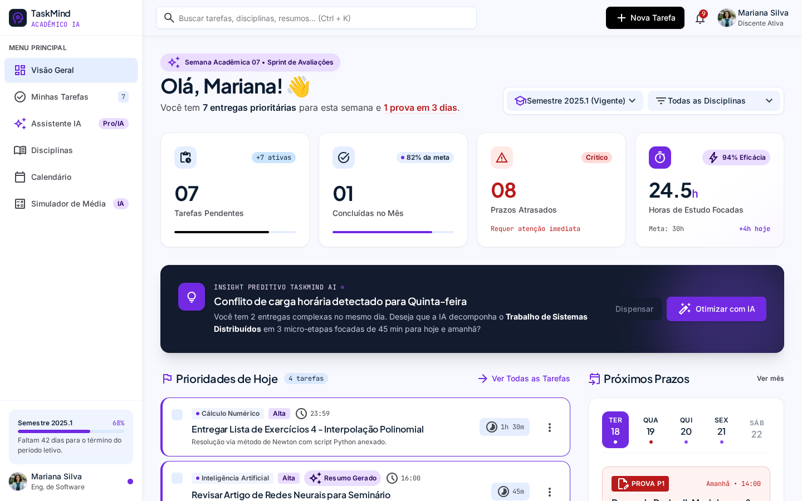
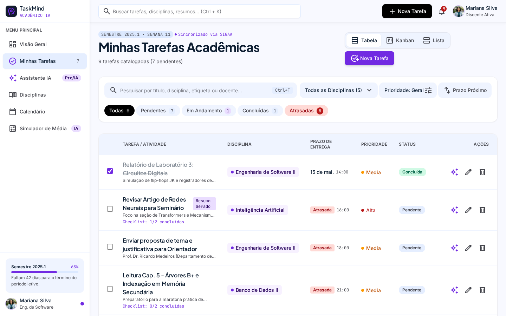
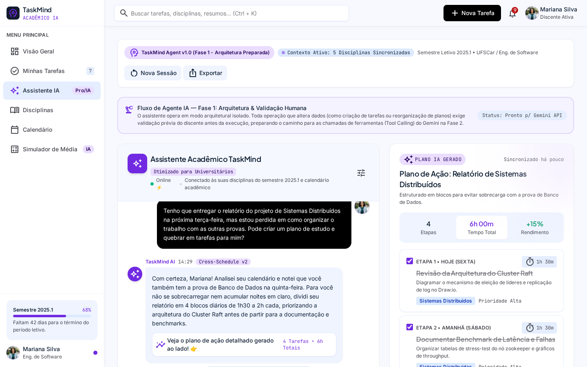
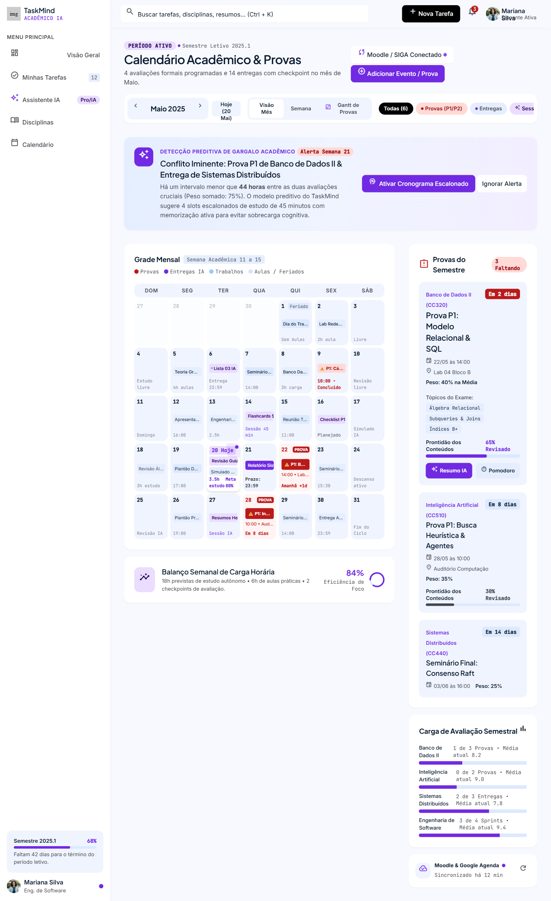
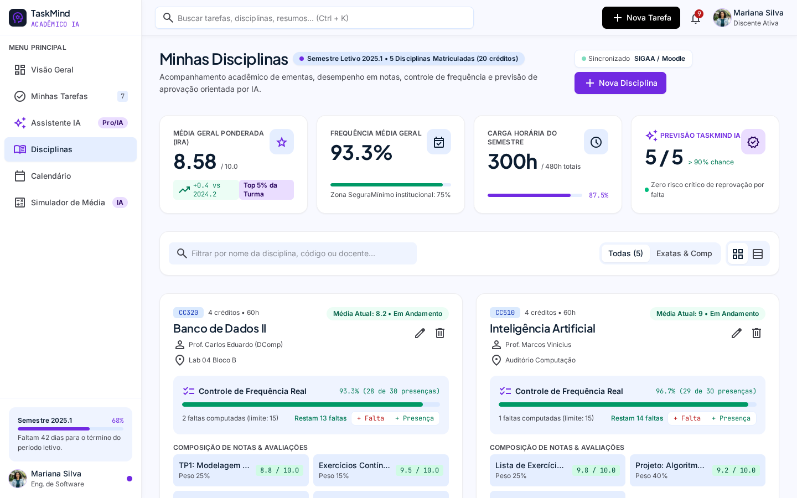
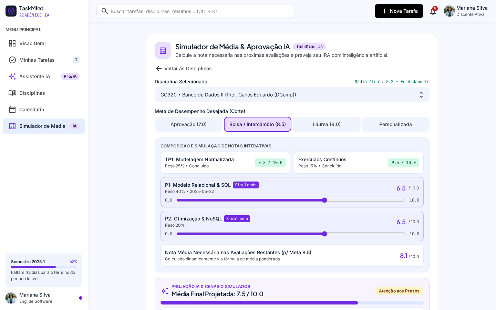
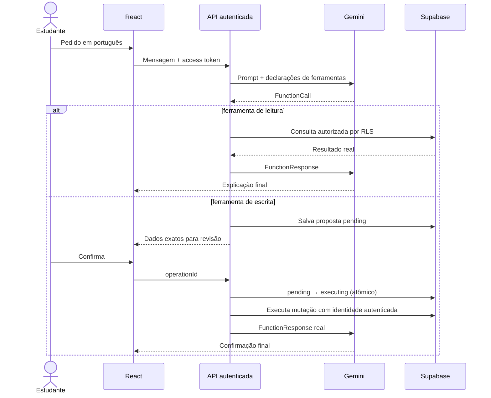
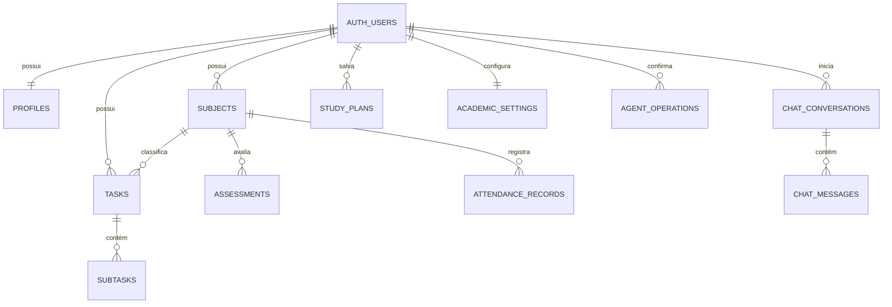

# TaskMind — produtividade acadêmica com agente Gemini

O TaskMind é uma aplicação acadêmica full stack para organizar tarefas, disciplinas, prazos, notas, frequência e planos de estudo. O projeto preserva as seis interfaces criadas no Google Stitch e adiciona autenticação, persistência relacional e um agente com function calling real.

> Estado atual: o código, migrations, testes e build estão preparados localmente. A integração remota só é considerada ativa depois que as migrations forem aplicadas a um projeto Supabase e as variáveis server-side forem configuradas. Nenhum deploy ou banco remoto foi alterado por esta implementação.

## Problema e justificativa

Informações acadêmicas costumam ficar fragmentadas entre portais, calendários e anotações. Isso dificulta visualizar carga de trabalho, antecipar atrasos, acompanhar frequência e saber qual nota ainda é necessária. O TaskMind centraliza esses dados e permite que um agente consulte e proponha alterações sem executar ações destrutivas silenciosamente.

## Objetivos

- Manter uma visão única e responsiva da rotina acadêmica.
- Persistir dados por usuário com integridade relacional e Row Level Security.
- Calcular médias, frequência e nota necessária com funções determinísticas.
- Usar Gemini para interpretar linguagem natural e selecionar ferramentas.
- Exigir confirmação humana para criação, edição e exclusão.

## Funcionalidades

### Implementadas no código

- Cadastro, login, logout, recuperação de senha e restauração de sessão pelo Supabase Auth.
- Rotas da aplicação protegidas por sessão.
- CRUD persistente de tarefas, subtarefas e disciplinas.
- Persistência de avaliações, frequência, conversas e planos de estudo.
- Dashboard, calendário e filtros derivados do estado sincronizado.
- Simulador acadêmico com tratamento de nota zero, dados ausentes e metas impossíveis.
- `/api/agent` autenticado, com rate limit, timeout, schemas allowlist e erros específicos.
- Ferramentas `listTasks`, `createTask`, `updateTask`, `deleteTask`, `listSubjects`, `suggestStudyPlan`, `calculateRequiredGrade` e `getAcademicOverview`.
- Confirmações persistidas e idempotentes no backend.
- Fallback local explicitamente identificado quando o Supabase não está configurado.

### Desabilitadas ou pendentes de configuração externa

- SIGAA, Moodle, biblioteca e comandos de voz não possuem API/credenciais e aparecem como indisponíveis.
- O ciclo real Supabase + Gemini requer aplicação das migrations, uma conta autenticada e segredos configurados.
- O teste SQL de isolamento RLS exige uma instância Supabase local descartável.

## As seis telas

| Tela | Captura |
|---|---|
| Dashboard |  |
| Tarefas |  |
| Assistente |  |
| Calendário |  |
| Disciplinas |  |
| Simulador |  |

As referências completas do Stitch estão indexadas em [`docs/design/README.md`](docs/design/README.md).

## Tecnologias

- React 19, React Router, Vite e Tailwind CSS.
- Node.js e Express no servidor local; Vercel Functions em produção.
- Supabase PostgreSQL, Auth e RLS.
- `@google/genai` para Gemini Developer API.
- `node:test` e ESLint.

## Arquitetura

```mermaid
flowchart LR
  Browser[React no navegador] -->|access token| API[/api/agent]
  Browser -->|CRUD com RLS| Supabase[(Supabase PostgreSQL)]
  Browser --> Auth[Supabase Auth]
  API -->|valida token| Auth
  API -->|contexto mínimo| Gemini[Gemini API]
  API -->|token do usuário + RLS| Supabase
  API -->|somente estado de confirmação| Ops[agent_operations]
  Ops --> Supabase
```

O token do usuário define a identidade. O backend nunca aceita `userId` enviado pelo navegador ou pelo modelo. A chave secreta `sb_secret_…` é usada apenas no servidor para controlar a máquina de estados privada de `agent_operations`; dados acadêmicos continuam sendo consultados e alterados com o token do usuário e RLS.

## Fluxo do agente e confirmação humana



Uma segunda confirmação recebe `409` e não repete a mutação. Falhas alteram a operação para `failed`; a interface não informa sucesso se a gravação falhar.

## Estrutura principal

```text
api/
  agent.js                 endpoint Vercel e orquestração
  _lib/agentTools.js       schemas, validação e ferramentas
src/
  components/              layout, autenticação e modais
  context/                 AuthContext e AcademicContext
  pages/                   seis telas preservadas
  services/                Supabase, repositório e agente cliente
  utils/                   cálculos acadêmicos puros
supabase/
  migrations/              schema e endurecimento de segurança
  tests/                   isolamento RLS executável localmente
tests/                      testes Node
server.js                   Vite + API no desenvolvimento local
```

## Modelo relacional



Todas as entidades usam UUID, constraints, timestamps, chaves estrangeiras e índices adequados. As migrations criam políticas SELECT, INSERT, UPDATE e DELETE separadas. Relações sem `user_id` verificam a propriedade pela entidade-pai.

## Variáveis de ambiente

Copie `.env.example` para `.env`. Não faça commit desse arquivo.

| Variável | Ambiente | Uso |
|---|---|---|
| `VITE_SUPABASE_URL` | navegador/servidor | URL pública do projeto |
| `VITE_SUPABASE_PUBLISHABLE_KEY` | navegador/servidor | chave publicável protegida por RLS |
| `SUPABASE_SECRET_KEY` | somente servidor | chave `sb_secret_…` para o estado idempotente das confirmações |
| `GEMINI_API_KEY` | somente servidor | Gemini Developer API |
| `GEMINI_MODEL` | somente servidor | modelo suportado configurável (`gemini-3-flash-preview` com fallback automático) |
| `APP_URL` | servidor | URL da aplicação e redirects |

Nunca use prefixo `VITE_` em `GEMINI_API_KEY` ou `SUPABASE_SECRET_KEY`.

## Instalação e execução local

Requisitos: Node.js 22+ e npm.

```bash
npm install
npm run dev
```

`npm run dev` inicia Express, a função `/api/agent` e o Vite na mesma origem. Use `TASKMIND_PORT` se a porta 3000 estiver ocupada. `npm run dev:frontend` inicia somente a interface e não serve o agente.

## Migrations e RLS

Para uma instância local descartável:

```bash
npx supabase start
npx supabase db reset
npx supabase test db
```

As migrations ficam em `supabase/migrations`. O teste `supabase/tests/rls_isolation.sql` alterna identidades e falha se um usuário conseguir ler a disciplina de outro. Para um projeto remoto, revise o diff e execute `supabase db push` somente após autorização explícita.

Em **Supabase Auth → URL Configuration**, configure `http://localhost:3000` e os domínios de preview/produção permitidos.

## Testes e qualidade

```bash
npm run lint
npm test
npm run build
npm run check
```

Resultado local em 10/11/2026:

- ESLint: aprovado, sem erros.
- Node test runner: 28 testes aprovados, 0 falhas.
- Vite build: aprovado.
- `npm audit --omit=dev`: 0 vulnerabilidades conhecidas.
- Endpoint local sem token: rejeitado com HTTP 401.
- Consulta de metadados do modelo `gemini-3.8-flash`: aprovada; tentativa de function calling real recebeu HTTP 503 por alta demanda temporária.
- Teste SQL RLS e ciclo remoto Gemini/Supabase: não executados, pois exigem migrations aplicadas e configuração externa.

Mocks são usados apenas para testar validação, timeout e idempotência isoladamente; não são apresentados como prova de integração remota.

## Vercel

1. Importe o repositório e mantenha o framework Vite.
2. Cadastre as seis variáveis da tabela nos ambientes Preview e Production apropriados.
3. Configure as Redirect URLs do Supabase para cada domínio autorizado.
4. Aguarde o workflow de lint/test/build antes de promover uma versão.
5. Valide login, consulta e confirmação em Preview.

`vercel.json` usa o fallback SPA oficial. A Vercel dá precedência aos arquivos/funções existentes antes do rewrite, portanto `/api/agent` permanece uma Function. Nenhum deploy é executado automaticamente por scripts deste repositório.

## Cronograma acadêmico — novembro de 2026

- **10/11:** base visual, domínio acadêmico e auditoria.
- **17/11:** persistência, autenticação, migrations e RLS.
- **24/11:** agente Gemini, testes integrados, documentação e preparação de entrega.

## Limitações e evoluções futuras

- Aplicar e validar as migrations em ambiente remoto autorizado.
- Executar o teste RLS em duas contas reais e o fluxo Gemini ponta a ponta.
- Adicionar testes E2E de navegador após disponibilizar um ambiente descartável.
- Implementar edição de perfil e configurações acadêmicas pela interface.
- Dividir o bundle principal, atualmente acima do aviso de 500 kB do Vite.
- Integrar sistemas institucionais somente quando APIs oficiais estiverem disponíveis.

## Créditos e autoria

- Concepção visual: Google Stitch.
- Prototipação inicial: Google AI Studio.
- Evolução full stack: desenvolvimento assistido por IA com revisão humana.
- Autor do repositório: **RHU4N**, conforme metadados existentes.
